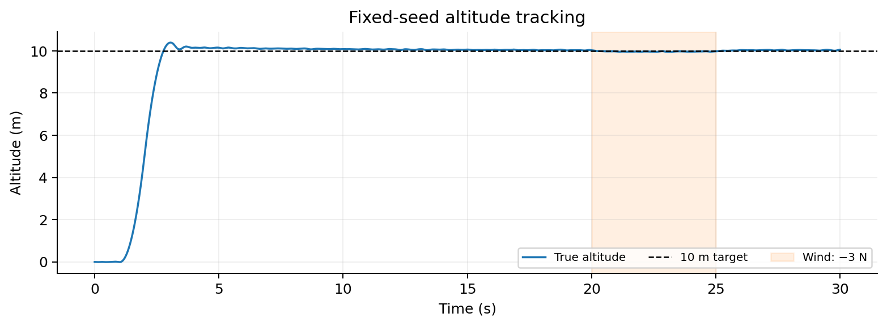
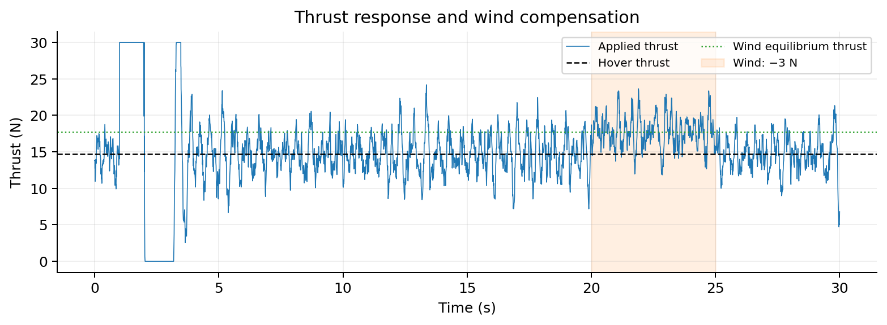
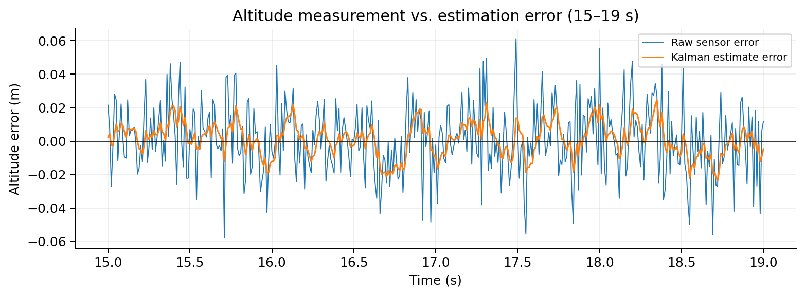
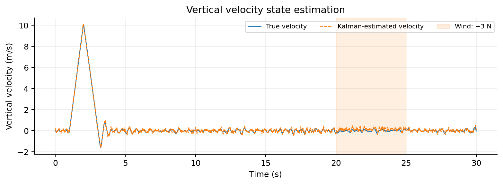

# Testing and Results

## Test configuration

| Condition | Final validation setup |
|---|---|
| Simulation duration | 30 s |
| Altitude reference | 10 m, step at 1 s |
| UAV mass | 1.5 kg |
| Thrust limits | 0–30 N |
| Sensor noise | Zero mean, standard deviation 0.02 m |
| Noise sampling | 100 Hz |
| Random Number block seed | 12345 |
| Wind disturbance | −3 N, 20–25 s |
| PID gains $(K_p,K_i,K_d)$ | $(46.5,4.38969736985132,27)$ |
| Derivative filter coefficient | 6.5 |
| Feedback | Kalman-estimated altitude |

The results were computed from exported fixed-seed simulation data. The project used iterative PID tuning; **Test 15** was selected as the final controller candidate. Values below reflect the fixed-seed validation run, not the earlier individual tuning run.

## Altitude step response

| Metric | Fixed-seed result |
|---|---:|
| ±1% settling time | 7.56 s |
| ±2% settling time | 2.72 s |
| Overshoot above 10 m | 3.93% |
| Maximum altitude | 10.3927 m |

Settling time is measured **from the 1 s reference step**, using the last exit from a ±1% or ±2% band **before the wind begins at 20 s**. The 2% band corresponds to ±0.2 m. Overshoot is the maximum altitude before the wind relative to the 10 m target.

## Wind disturbance rejection

| Metric | Fixed-seed result |
|---|---:|
| Disturbance force and interval | −3 N, 20–25 s |
| Maximum absolute altitude error during wind | 0.04957 m (4.96 cm) |
| Mean thrust, 15–20 s | 14.681 N |
| Mean thrust, 20–25 s | 17.772 N |
| Mean thrust increase | 3.092 N |
| Thrust standard deviation, 15–20 s | 2.834 N |
| Thrust standard deviation, 20–25 s | 2.224 N |

The theoretical thrust needed to hold altitude under a steady −3 N downward force is 17.715 N, versus 14.715 N in calm hover. The observed mean thrust increase is consistent with compensation, while instantaneous thrust varies due to closed-loop response and measurement noise.

## Altitude estimation accuracy

Root-mean-square error (RMSE) against true simulated altitude is

$$
\mathrm{RMSE} =
\sqrt{
\frac{1}{n}
\sum_{i=1}^{n}
(\hat{z}_i-z_i)^2
}
$$

| Metric | Result |
|---|---:|
| Raw noisy altitude measurement RMSE | 0.019887 m (1.989 cm) |
| Kalman altitude estimate RMSE | 0.009352 m (0.935 cm) |
| Relative RMSE reduction | **52.97%** |

The percentage is calculated as $100(1-\mathrm{RMSE}_{\mathrm{Kalman}}/\mathrm{RMSE}_{\mathrm{sensor}})$, over the entire 30 s run. Lower overall RMSE does not guarantee a lower error at every instant.

## Vertical velocity estimation accuracy

| Metric | Result |
|---|---:|
| Full-run vertical velocity RMSE | **0.1112 m/s** |
| Full-run mean absolute error | 0.0884 m/s |
| Wind-interval vertical velocity RMSE (20–25 s) | 0.1685 m/s |

The filter estimates velocity even though the PID controller currently feeds back only estimated altitude. Estimation error increases during the wind interval, consistent with an unmodeled external force.

## Fixed-seed repeatability

A second run with the same model configuration and Random Number seed produced **identical logged altitude and thrust samples** (3,030 samples per signal). The maximum samplewise difference was 0 m for altitude and 0 N for thrust. This verifies repeatability **under unchanged simulation conditions**; it does not establish statistical robustness across different noise seeds.

## Limitations

These are simulated results for a simplified one-dimensional vehicle. They do not establish real-flight performance, 3D stabilization, actuator dynamics, robustness to multiple sensor-noise realizations, or performance with varying vehicle mass and model uncertainty. The reported metrics should be interpreted as a fixed-seed validation, not a multi-trial statistical estimate.
